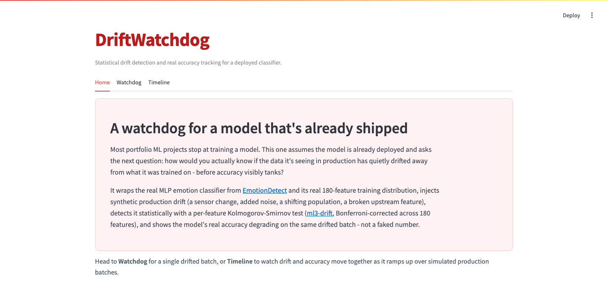
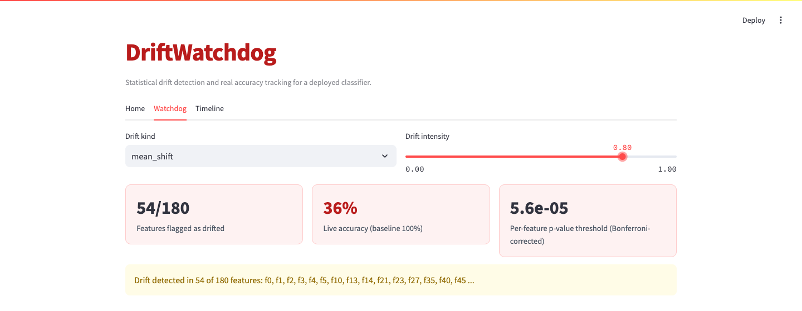
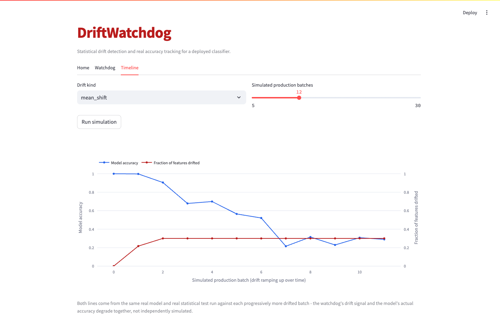

# DriftWatchdog

    

Watches a real, already-deployed classifier for data drift. It wraps a real
MLP classifier and its 180-feature training distribution, injects synthetic
production drift (a sensor change, added noise, a shifting population, a
broken feature) at an adjustable intensity, detects it with a per-feature
Kolmogorov-Smirnov test Bonferroni-corrected across all 180 features, and
tracks the model's real accuracy on the same drifted batch - so the
Timeline view shows the drift signal and the actual accuracy decay moving
together.

## Screenshots





## How to run

```bash
python -m venv .venv
source .venv/bin/activate
pip install -r requirements.txt
streamlit run app.py
```

Tests: `python -m pytest tests/ -v`
